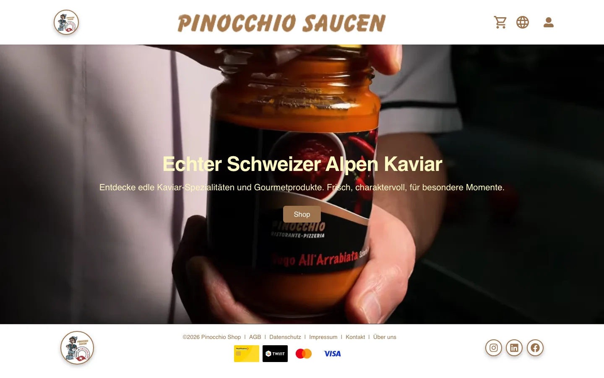

# Pinocchio Shop – Front End

Multilingual online shop for sauces and delicacies, built as a React single-page app: product
catalogue, cart, checkout, customer account with Google sign-in and admin pages for products and
orders. Talks to a separate REST API (not part of this repository).



## Features

- Shop with category filter, sorting and pagination; product pages
- Cart with mini cart; checkout with shipping and billing address
- Customer account: sign-up, sign-in by email or Google, own orders, profile
- Admin pages: create and edit products (basic data, category, features, images, sizes);
  filter and edit orders
- UI in German, English, French and Italian; product texts can be translated automatically
  through the Google Translate API
- Legal notice, privacy policy, contact and about pages

## Stack

React 19 · Vite 7 · React Router 7 · TanStack Query 5 · Axios · Tailwind CSS 3 · `@react-oauth/google` · Swiper · React Toastify

```
src/pages/        one component per route
src/components/   header, footer, product card, filters, cart, product form sections
src/contexts/     AuthContext, CartContext, I18nContext
src/services/     API client (Axios) and one service per resource
src/utils/        security helpers, product i18n
```

## Getting started

```bash
npm ci
cp .env.example .env    # then fill in the values below
npm run dev             # http://localhost:3000, /api is proxied to the shop API
npm run build && npm run preview
```

| Variable | Purpose |
|---|---|
| `VITE_API_BASE_URL` | Base URL of the shop API |
| `VITE_GOOGLE_CLIENT_ID` | OAuth client ID for Google sign-in |
| `VITE_GOOGLE_TRANSLATE_API_KEY` | Optional – enables automatic translation of product texts |

All `VITE_*` values are compiled into the public JavaScript bundle. Only put values there that may be
public (an OAuth client ID is); restrict a Translate API key to the site's HTTP referrer.

## Security notes

- Expired tokens are detected and the session is ended; admin pages require the `Admin` role.
- Checkout input is sanitised before it is sent; in production the app redirects to HTTPS.
- The access token is kept in browser storage. For a production shop, the API should set it as an
  `httpOnly` cookie instead and protect state-changing requests against CSRF – that needs a change
  in the API, not only in this front end.
